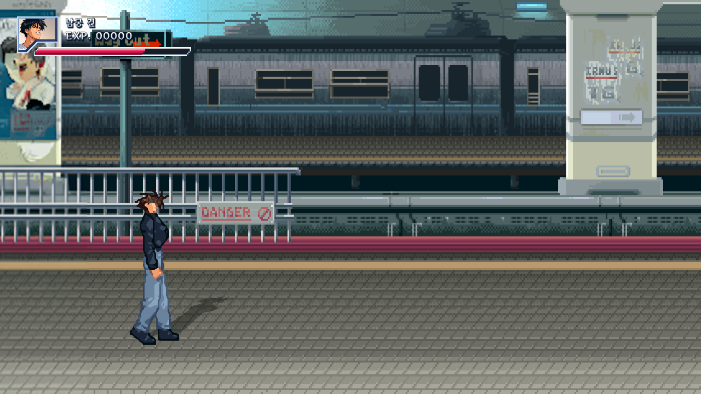
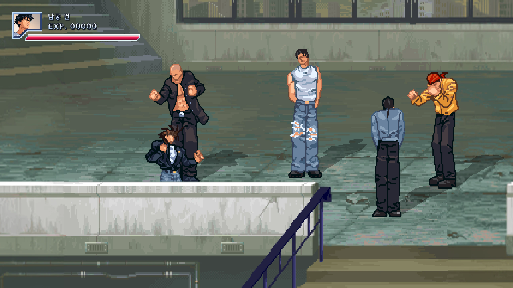
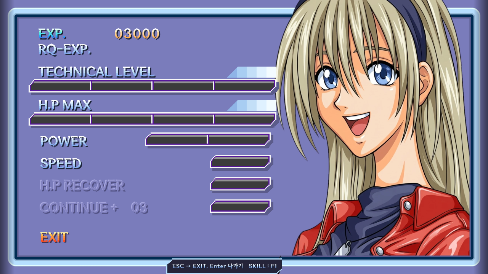

# 어쩐지 좋은일이 생길것 같은 저녁 — HD 리마스터

1997년 T.G Entertainment 의 DOS 벨트스크롤 액션 게임 「어쩐지 좋은일이 생길것 같은 저녁」을
팬이 개인적으로 다시 만든 **비공식·비영리 리마스터**입니다. 원저작권자와는 관계가 없으며, 판매하지 않습니다.

## 받기와 실행
1. 오른쪽 **Releases** 에서 최신 판의 `.zip` 파일을 받습니다.
2. 압축을 풉니다.
3. `어쩐지저녁_HD\NightHD.exe` 를 두 번 누릅니다. 설치나 다른 프로그램은 필요 없습니다.

## 필요한 PC
- Windows 10 / 11 64비트
- Vulkan 을 지원하는 그래픽카드 (최근 몇 년 안의 NVIDIA·AMD·Intel 그래픽이면 대부분 됩니다)
- 저장 공간 약 450MB

## 기본 조작 (설정 화면에서 바꿀 수 있고, 게임패드도 됩니다)
| 버튼 | 키 |
|---|---|
| 이동 | 방향키 |
| 주먹 (P) | Z |
| 발 (K) | X |
| 점프 (J) | C |
| 앉기 | Space |
| 시작 / 고르기 | Enter |
| 멈춤 | Esc |
| 전체 화면 | F11 |

기술 목록과 커맨드는 멈춤 메뉴의 **COMMAND LIST** 에서 볼 수 있습니다.

## 리마스터에서 달라진 것
- 16:9 넓은 화면, HD 배경과 효과, 캐릭터 그림 선택 (레거시 / 리마스터)
- 새로 만든 리마스터 배경음악 (설정에서 원작 음악으로 바꿀 수 있음)
- 커맨드 입력 개선, 난이도 선택 (EASY / NORMAL / HELL), 연습 모드
- 판정과 조작감은 원작을 기준으로 맞춤

## 저작권
자세한 내용은 [저작권_안내.txt](저작권_안내.txt) 를 보세요.
- 원작과 원작에서 온 모든 자료의 저작권은 원저작권자에게 있으며, 배포자는 어떠한 권리도 주장하지 않습니다.
- 새로 만든 리마스터 배경음악의 저작권만 배포자에게 있습니다.
- 원저작권자 또는 관련된 분이 요청하시면 배포를 바로 멈추고 공개한 모든 자료를 삭제합니다.
- 무료로만 나눌 수 있습니다.

글꼴: 넥슨코리아 DNF ForgedBlade, DNF BitBit · 게임 엔진: Godot Engine (MIT)
